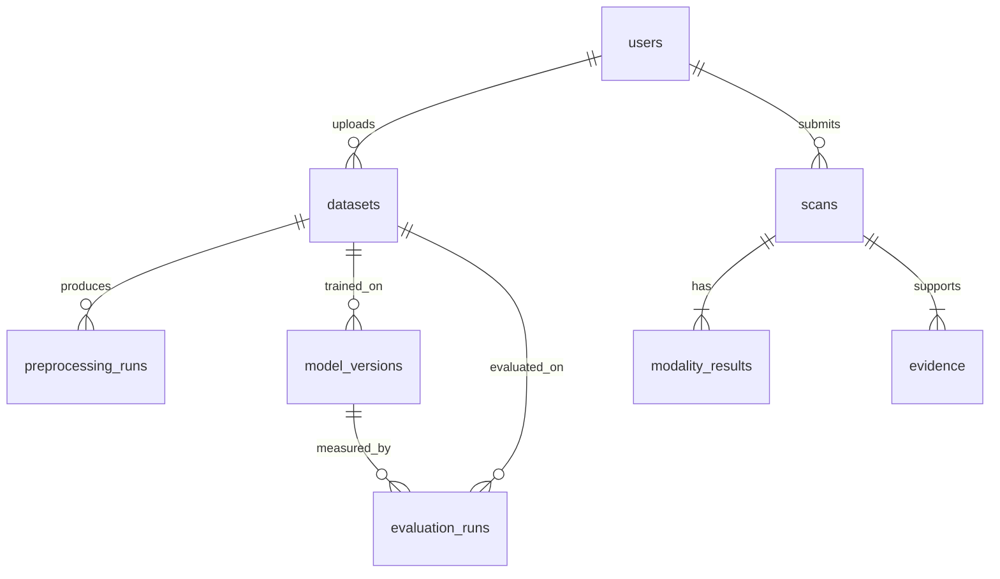

# PhishGuard AI — Multimodal Phishing Detection and Real-Time Browser Protection Platform

B.Tech final-year project: a full-stack platform that detects phishing across **four input
categories — websites/URLs, emails, SMS and QR codes** — by fusing modality-specific
analyses (URL-feature ML, DOM/text rules, NLP, vision) into one **explainable risk verdict,
persisted in PostgreSQL**, with a React dashboard and a **Chrome MV3 extension** providing
real-time browser protection.

> **Honesty policy (project rule):** every metric shown anywhere in this project is either
> measured and stored, or displayed as `NULL`/empty/"not trained". Seeded demonstration
> rows are flagged `is_seed_data=true` / `is_synthetic=true` and labelled in the UI.
> No fabricated numbers, no synthetic data presented as real, no fake UI functionality.
> A module that cannot run reports `MODEL_MISSING`/`FAILED` and the report gains an
> explicit caveat — it is never silently assumed safe.

**Current verified status lives in [`PROJECT_STATUS.md`](PROJECT_STATUS.md)** (updated with
every change; includes measured metrics, known gaps and the honest "not done" list).

---

## What is verified working today

| Area | State | Evidence |
|---|---|---|
| Website/URL scan (fetch + fusion + SHAP) | ✅ | Live scans through UI and API, e.g. scans #11–12 |
| Email / SMS / QR scan | ✅ | Scans #3 (SMS scam), #4 (benign mail), #7 (phishing QR, multipart upload) |
| URL models (RF + XGBoost, v3 host-only) | ✅ trained & measured | hold-out acc **0.956 / 0.958**, ROC-AUC **0.980 / 0.984**; real-world sanity **38/40, 0 phishing missed** |
| Vision CNN (screenshot scoring) | ⛔ `MODEL_MISSING` | torch not installed — screenshot is still captured as evidence; fusion renormalises + caveats |
| NLP / DOM "models" | ✅ rule-based (honest labels) | `lexicon_rule_scorer` / `dom_rule_scorer` — transparent, not learned |
| PostgreSQL persistence of full reports | ✅ | scans + modality_results + evidence (severity/direction/kind) + result_json + screenshot ref |
| Accounts, sessions & roles (Spring Security) | ✅ verified end-to-end | register (first account → ADMIN) · login · logout · profile edit · change-password exercised in a browser; member session → 403 on research API; anonymous scan POST → 200 (extension), anonymous `GET /api/scans` → 401; BCrypt storage only (Flyway V8) |
| Spring Boot JUnit tests | ✅ **42/42** | `mvn test` (14 auth + 6 ownership + 14 controller + 8 persistence) |
| Python test suites | ✅ **8/8 suites, 63 explicit checks** | 28 feature + 16 explainability + 13 fetch-safety + 6 blocked-URL + 4 e2e demo suites |
| Chrome MV3 extension | ✅ code complete | `browser-extension/` (load-unpacked; manual browser test still pending) |
| Docker Compose deployment | ✅ built & verified | all 3 images build; `docker compose up -d` → 4 containers healthy; live scan through nginx returned LEGITIMATE/LOW with SHAP contributors; torn down cleanly |
| Manual preprocessing workflow (STEP 1–6) | ✅ | `scripts\test-api-demo.ps1` → ALL CHECKS PASSED |

**Compatibility changes made on this machine (documented, not silent):**

- Backend port **8080 → 8088** — another Java process already occupied 8080.
- Maven 3.9.9 is not installed globally; `scripts\env.ps1` adds the local copy to `PATH`.
- PowerShell execution policy blocks `.ps1` by default — scripts are run with
  `powershell -ExecutionPolicy Bypass -File …`.
- Use `npm.cmd` / `mvn.cmd` (not `npm`/`mvn`) when the PowerShell policy blocks `npm.ps1`.

---

## Architecture

```
        ┌────────────────────────────── input categories ──────────────────────────────┐
        │  Website/URL        Email            SMS               QR code               │
        └──────┬────────────────┬─────────────────┬──────────────────┬─────────────────┘
               ▼                ▼                 ▼                  ▼
        ┌─────────────────────────────────────────────────────────────────────────────┐
        │                        Python FastAPI AI service (:8000)                    │
        │  per-input pipelines: URL-ML + DOM rules + NLP lexicon + vision (missing)   │
        │  QR payload decode (OpenCV) · SSRF-safe fetcher · SHAP explainability       │
        │                    Hybrid fusion engine (weighted, renormalised)            │
        └──────────────────────────────────┬──────────────────────────────────────────┘
                                           │ HTTP (JSON)
        ┌──────────────────────────────────▼──────────────────────────────────────────┐
        │                        Spring Boot 3 API (Java 21, :8088)                   │
        │  Bean Validation · AiServiceClient · persistence (JPA + Flyway V1–V8)       │
        │  scan storage + evidence rows + screenshot streaming · health aggregation   │
        └──────────────┬──────────────────────────────────────┬───────────────────────┘
                       │ JDBC                                 │ REST
              ┌────────▼─────────┐         ┌──────────────────▼──────────────────────┐
              │ PostgreSQL 17    │         │  React 19 + TS dashboard (:5173)        │
              │ phishing_        │         │  Dashboard · 4 scanners · History      │
              │ detection        │         │  Scan History · Report · Models (URL-only)  │
              └──────────────────┘         └──────────────────┬──────────────────────┘
                                                              │ REST (host_permissions)
                                               ┌──────────────▼──────────────────────┐
                                               │  Chrome MV3 extension               │
                                               │  per-navigation verdict badge       │
                                               │  PHISHING interstitial + report link│
                                               └─────────────────────────────────────┘
```

- The React app **never talks to Python directly** — every request goes through Spring Boot,
  which owns validation, persistence and the audit trail. The dashboard calls the same-origin
  `/api` path (Vite proxies it in dev, nginx in Docker), so production builds never hardcode
  a host.
- The dashboard UI is a light, accessible (Lighthouse: accessibility 100, best practices 100),
  responsive product interface: a user Dashboard plus a dedicated page per scanner
  (Website / Email / SMS / QR) and Scan History in plain language, each scanner reachable
  directly from the sidebar; research pages (Dataset & Training, Model Performance,
  Evaluations) are routed but kept out of the user navigation **and** restricted to
  administrator accounts (an honest "administrator access required" panel in the UI,
  HTTP 403 from the server for members), and developer diagnostics (service topology,
  database counts) live in a clearly marked collapsible section of System Status,
  whose route requires signing in (the `/api/health` endpoint itself stays public for
  ops/Docker healthchecks, as the page discloses).
- Spring Boot calls Python over HTTP (`AiServiceClient`); file exchange (QR uploads,
  screenshots, processed CSVs) happens in the shared `uploads/` directory.
- **Blocked/unsafe URLs never reach the network**: scheme/port allow-lists, DNS resolution
  private-IP checks (loopback, link-local, cloud metadata, RFC1918), redirect
  re-validation, bounded bytes/time, userinfo rejection — a refusal becomes a `CRITICAL`
  finding, never a clean verdict.

## Accounts and access

- **Creating the first account**: open <http://localhost:5173/register>. On a fresh
  database the first account registered becomes the **administrator**; later accounts
  are members. The seeded `demo_admin` / `demo_viewer` rows have sentinel password
  hashes and can *never* sign in — they exist only as data.
- **Sessions are server-side**: signing in creates an HTTP-only `JSESSIONID` cookie
  (SameSite=Lax, 8-hour idle timeout). The password travels once to the API and is
  stored only as a BCrypt hash; no hash, cookie or token is ever exposed in the UI.
  Restarting the backend clears active sessions (in-memory store).
- **Roles**: administrators get the research workspace (datasets, preprocessing,
  models, evaluations) — the UI shows an honest *Administrator access required*
  panel and the server returns **403** for members. Every signed-in account can edit
  its profile (display name, email) and change its password.
- **Scan visibility**: signed-in users see their own scans plus unattributed scans
  (`user_id IS NULL` — anonymous API/extension runs on the same device, shown as
  shared scans). Another account's scans return **404**, so histories are not
  enumerable.
- **Anonymous on purpose**: the four `POST /api/scans…` endpoints and `/api/health`
  require no session — that keeps the Chrome extension, curl demos and Docker
  healthchecks working without a login. Everything else under `/api/**` requires
  sign-in (`401 authentication_required`); research routes additionally require the
  ADMIN role (`403 forbidden`).
- **Not implemented (documented, not faked)**: password reset (no mail service),
  two-factor authentication, and account lockout/brute-force throttling beyond the
  generic `Invalid username or password.` message.

---

## Repository layout

```
├── backend/                 Spring Boot API (Maven, Java 21) + JUnit tests
│   └── src/main/resources/db/migration/   Flyway V1–V8 (schema, seed, multimodal cols, auth)
├── ai-service/              Python FastAPI service (.venv, Python 3.11) + pytest/script suites
│   ├── app/pipelines/       website.py · email.py · sms.py · qr.py
│   ├── app/ml/              url_features.py (16 host-only features)
│   ├── app/models/          url_model.py (RF+XGB ensemble, SHAP contributors)
│   ├── app/acquisition/     fetcher.py + url_safety.py (SSRF hardening)
│   ├── app/risk/            engine.py (fusion + risk assessment) · rulescores.py
│   ├── training/            train_url_models.py (v3) + sanity evaluation
│   └── tests/               8 test suites (63 explicit checks)
├── frontend/                React 19 + TypeScript + Vite dashboard (nginx for Docker)
├── browser-extension/       Chrome MV3 extension (background/content/popup + icons)
├── database/                schema, migrations, seed, demo queries, ER diagram
├── datasets/                sample CSVs + url_sanity_realworld.csv (40 hand-labelled URLs)
├── models/                  trained artifacts (joblib + metadata + training JSON)
├── scripts/                 setup-database · start-all/stop-all · start-backend/…
├── docker-compose.yml       postgres + ai-service + backend + frontend (nginx)
└── PROJECT_STATUS.md        honest, measured status of everything
```

---

## Quick start

### Option A — everything at once (recommended)

```powershell
powershell -ExecutionPolicy Bypass -File scripts\setup-database.ps1   # one-time DB setup
powershell -ExecutionPolicy Bypass -File scripts\start-all.ps1        # starts all services
```

Then open <http://localhost:5173> → create your account (on a fresh database the
**first** account registered becomes the administrator) or sign in → pick a scanner
from the sidebar → scan. Anonymous API users (curl, the Chrome extension) can skip
this: scan POSTs work without a session.
The services are started **detached** (they survive closing the terminal;
logs: `logs\ai-service.log`, `logs\frontend.log`, `backend\spring-boot.log`).
Stop with `scripts\stop-all.ps1` (PostgreSQL keeps running).

### Option B — service by service

```powershell
# Terminal 1 — Python AI service (127.0.0.1:8000)
powershell -ExecutionPolicy Bypass -File scripts\start-ai-service.ps1

# Terminal 2 — Spring Boot API (8088)
powershell -ExecutionPolicy Bypass -File scripts\start-backend.ps1

# Terminal 3 — dashboard (5173)
powershell -ExecutionPolicy Bypass -File scripts\start-frontend.ps1
```

### Option C — Docker

```powershell
docker compose up --build
```

Dashboard `http://localhost:5173` (nginx proxies `/api` to the backend; the AI service and
PostgreSQL stay internal to the compose network; `./models` is mounted read-only and the
shared `uploads` volume mirrors the local layout). The containerized stack uses its **own**
PostgreSQL volume — scans made through it do not appear in the local development database.

**Credentials (local development only — see `.env.example`; never commit real secrets):**

| Purpose | User | Password |
|---|---|---|
| PostgreSQL superuser (setup only) | `postgres` | `postgres` |
| Application role (Flyway + runtime) | `phish_app` | `change_this_password` (override with `SPRING_DATASOURCE_PASSWORD`) |

---

## The detection pipeline (what actually runs)

Each input category runs **its own** modules — there is no one-size-fits-all classifier —
and the results feed one shared evidence/risk framework:

| Input | Modules that run | Fusion weights used |
|---|---|---|
| **Website/URL** | URL-feature ML (RF+XGBoost ensemble) · fetched-HTML/DOM rules · page-text NLP rules · form/link rules · screenshot (captured; CNN `MODEL_MISSING`) | URL 0.18 · HTML 0.26 · NLP 0.20 · VISION 0.18 · FORM_LINK 0.18 |
| **Email** | NLP (urgency/secrecy/credential-request lexicon) · embedded-URL analysis · sender/header metadata rules | NLP 0.45 · URL 0.35 · METADATA 0.20 |
| **SMS** | NLP · link analysis (links are **analysed as strings, never visited**) · sender/length metadata | NLP 0.60 · URL 0.30 · METADATA 0.10 |
| **QR** | OpenCV payload decode (grayscale + 2× retry) → decoded URL analysed safely, never fetched · payload metadata | URL 0.80 · METADATA 0.15 · NLP 0.05 |

- Fusion weights are **renormalised over the modules that actually ran**; every report
  shows the weights it used plus a `caveats` list (e.g. "Some modalities were unavailable
  (VISION)… An incomplete scan is not the same as a clean scan.").
- **Explainability**: signed SHAP contributors for the URL models (▲ toward phishing /
  ▼ toward legitimate; the unsigned impurity fallback is reported as `neutral` and says
  so), every evidence item carries severity + direction + FINDING/INFERENCE kind, and
  `riskScore` is always labelled "a fused model score in [0,1], not a calibrated
  probability".

### URL model note (the project's central accuracy finding)

PhiUSIIL's legitimate URLs are all bare domains, so path-based features were a **dataset
artifact** (fake-but-perfect accuracy that failed on real URLs). v3 trains on **16
host-only features**, trading ~4 points of hold-out accuracy for real-world sanity
(38/40 with zero missed phishing). See `PROJECT_STATUS.md` §3 for the full story.

---

## API summary

| Method & path | Purpose |
|---|---|
| `GET  /api/health` | backend + DB + AI-service health, table row counts |
| `POST /api/scans/website` | website scan: `{url, fetch?, render?}` (fetch/render default **true**) |
| `POST /api/scans/email` | email scan: `{subject, body, sender?, headers?}` |
| `POST /api/scans/sms` | SMS scan: `{message, sender?, analyzeLinks?}` |
| `POST /api/scans/qr` | QR scan: multipart `file` (PNG/JPG, ≤10 MB) |
| `POST /api/scans` | generic dispatcher (`inputType` selects the branch above) |
| `GET  /api/scans` · `/api/scans/history` · `/api/scans/{id}` | scan list / recent / full report |
| `GET  /api/scans/{id}/screenshot` | streams the stored render (404 if none exists) |
| `GET/POST /api/datasets…`, `/api/preprocessing-runs…` | dataset + preprocessing workflow |
| `GET  /api/models` · `/api/evaluations` · `POST /api/models/registrations` | model registry / evaluations |
| `POST /api/auth/register` · `/login` · `/logout` | create account (first one → ADMIN) / sign in / sign out — server-side session |
| `GET  /api/auth/me` · `PATCH /api/auth/profile` · `POST /api/auth/change-password` | current identity / edit display name + email / change password |

**Access**: the scan POSTs and `/api/health` are open (extension and demo friendly);
every other `/api/**` route requires a session (`401 authentication_required`), and
the dataset/preprocessing/model/evaluation routes additionally require the `ADMIN`
role (`403 forbidden`).

Scan responses are the **engine payload plus `id`/`inputType`** — the report page renders
it verbatim (modalities, evidence, caveats, weights, screenshot reference).
If the Python service is down, scans fail honestly with **503** (+start hint); an
AI-service crash surfaces as **502**, never as a verdict.

## Testing

```powershell
# Java — 42 tests: auth contract (register/login/logout/session, first-admin
# rule, generic 401s, password change, profile update), scan ownership and
# visibility (owner attribution, cross-account 404, anonymous unattributed),
# controller contract (validation, delegation, 5xx mapping) and persistence
# normalisation (CHECK-safe enums, screenshot path handling)
cd backend; mvn test

# Python — 8 suites: feature extraction (28), SHAP explainability (16),
# fetch hardening (13), blocked URLs (6), plus 4 end-to-end demonstration suites
cd ai-service
$env:PROJECT_ROOT = (Resolve-Path ..)
.venv\Scripts\python -m tests.test_website_core
.venv\Scripts\python -m tests.test_url_explain
.venv\Scripts\python -m tests.test_fetcher_hardening
.venv\Scripts\python -m tests.test_blocked_urls
```

## Browser extension

`browser-extension/` — load unpacked via `chrome://extensions` (Developer mode).
It asks the backend per navigation, badges the verdict, and shows a styled
interstitial for PHISHING + HIGH/CRITICAL with the top evidence. Backend failure shows
an `err` badge — it never guesses "safe". Details and design rationale:
[`browser-extension/README.md`](browser-extension/README.md).

---

## DATABASE AND DATA PREPROCESSING DEMONSTRATION

This section is the college demonstration script for the database and the reproducible
manual preprocessing workflow. Everything below runs against the live PostgreSQL instance.

### 1. ER diagram

Full diagram with column types and design notes: [`database/er-diagram.md`](database/er-diagram.md).



The eight required tables: `users`, `datasets`, `preprocessing_runs`, `scans`,
`modality_results`, `evidence`, `model_versions`, `evaluation_runs`.

Key design points:

- `evaluation_runs` metric columns are **nullable** — `NULL` means *not measured yet*,
  never a fabricated 0.
- `datasets.is_synthetic` and `scans.is_seed_data` mark demo rows so they can never be
  mistaken for real observations (surfaced in the UI).
- `preprocessing_runs` stores the **exact parameters, counts, warnings and the full
  Python result JSON** for every run — preprocessing is auditable and repeatable.
- Multimodal scans (V6/V7): `scans.input_type`, full `scans.result_json`,
  `scans.screenshot_file`, and `evidence.direction`/`kind` with CHECK constraints.
- Schema changes are applied twice, deliberately: plain SQL (`database/migrations/`) for
  `setup-database.ps1`, and Flyway copies (`backend/src/main/resources/db/migration/`)
  for the application. Flyway owns the schema at runtime (`ddl-auto=validate`).

### 2. Setup commands

```powershell
# Provision everything (idempotent - safe to re-run)
powershell -ExecutionPolicy Bypass -File scripts\setup-database.ps1

# Inspect what was created
psql -U postgres -d phishing_detection -c "\dt"
psql -U postgres -d phishing_detection -c "SELECT version, description, success FROM flyway_schema_history ORDER BY installed_rank;"
```

### 3. Example SQL

Analytics queries live in [`database/queries/demo_queries.sql`](database/queries/demo_queries.sql)
(9 queries: table counts, dataset→run history, transformations JSON, scan verdicts,
modality breakdown, evidence, model registry, evaluation runs, orphan check).

```powershell
psql -U phish_app -d phishing_detection -f database\queries\demo_queries.sql
```

The two most useful for the demo:

```sql
-- Every preprocessing run with before/after counts (the audit trail)
SELECT p.id AS run_id, d.name AS dataset, p.status,
       p.input_rows, p.output_rows,
       p.duplicates_removed, p.invalid_rows_removed, p.missing_values_handled,
       p.parameters_json
FROM preprocessing_runs p
JOIN datasets d ON d.id = p.dataset_id
ORDER BY p.started_at DESC;

-- A live multimodal scan with its modules and evidence
SELECT s.id, s.input_type, s.final_prediction, s.risk_level, s.risk_score, s.status,
       m.modality, m.model_name, e.severity, e.direction, e.evidence_type
FROM scans s
LEFT JOIN modality_results m ON m.scan_id = s.id
LEFT JOIN evidence e ON e.scan_id = s.id
WHERE s.is_seed_data = false
ORDER BY s.id DESC, m.id, e.id LIMIT 20;
```

### 4. The manual preprocessing workflow (STEP 1–6)

Dashboard page: **Dataset management** (`http://localhost:5173/datasets`).

| STEP | What happens | API | Evidence in DB |
|---|---|---|---|
| 1 · Upload | CSV chosen in the browser, metadata stored, file written to `uploads/` | `POST /api/datasets/upload` | row in `datasets` (`status=UPLOADED`, `is_synthetic` flag) |
| 2 · Preview | Python profiles the file: dtypes, missing %, duplicates, label distribution | `GET /api/datasets/{id}/preview?targetColumn=label` | `datasets.total_rows`, `column_names`, `status=INSPECTED` |
| 3 · Choose operations | User ticks exactly which operations run — nothing is automatic | (form state) | parameters echoed in STEP 4 |
| 4 · Execute | Spring writes the run (`RUNNING`), calls Python, stores the full result | `POST /api/datasets/{id}/preprocessing-runs` | `preprocessing_runs` row: counts, `transformations_applied`, `warnings_json`, `result_json`, `output_filename` |
| 5 · Results | Before/after class balance, per-operation rows, warnings | `GET /api/preprocessing-runs/{id}` | same row (`status=COMPLETED` or `FAILED` + `error_message`) |
| 6 · Export & audit | Download the processed CSV; the original file is never modified | `GET /api/preprocessing-runs/{id}/download` | file under `uploads/processed/`, run row permanent |

The same workflow runs headlessly:

```powershell
# API-level end-to-end test (11 checks, hits PostgreSQL at the end)
powershell -ExecutionPolicy Bypass -File scripts\test-api-demo.ps1

# Standalone Python demo - no services required
cd ai-service
.\.venv\Scripts\python.exe preprocessing\run_preprocessing_demo.py
```

Measured on the bundled `datasets\sample_urls_demo.csv` (23 rows, **synthetic demo data**):

```
input rows ......... 23
output rows ........ 17
duplicates removed . 3   (incl. 1 conflicting-label pair)
invalid rows ....... 2   (empty/missing label)
missing handled .... 1   (strategy = drop_rows)
label mapping ...... suspicious -> phishing
class balance ...... before: phishing=13 legitimate=9 suspicious=1
                     after:   phishing=9  legitimate=8
elapsed ............ ~31 ms (pandas pipeline)
```

Fixed pipeline order (so results are reproducible):
`normalize_labels → drop_invalid_rows → convert_types → detect_conflicting_duplicates →
handle_missing → remove_duplicates → dedupe_on_column → drop/select columns →
validate_features (report-only)`.

### 5. Verifying rows in PostgreSQL (live)

```powershell
psql -U postgres -d phishing_detection -c `
  "SELECT id, dataset_id, status, input_rows, output_rows, duplicates_removed, output_filename
   FROM preprocessing_runs ORDER BY id DESC LIMIT 5;"
```

### 6. Screenshot instructions (for the report)

Take these with the three services running (`:5173`, `:8088`, `:8000`):

| # | Page | What to capture |
|---|---|---|
| 1 | `http://localhost:5173/health` | Overall/PostgreSQL/AI = UP + database row counts table |
| 2 | `http://localhost:5173/datasets` | STEP 1–6 sections, "Datasets in PostgreSQL (n)" table with `is_synthetic` origin |
| 3 | Same page, STEP 2 after **Inspect** | column profile + label distribution bars |
| 4 | Same page, STEP 5 after **Execute** | before/after class balance, transformation rows, warnings |
| 5 | Same page, STEP 6 | audit table: run id, counts, status, download button |
| 6 | psql window from §5 | the `preprocessing_runs` row proving DB persistence |
| 7 | `http://localhost:5173/` | Dashboard: four scanner feature cards + real stats + recent scans (live counts) |
| 8 | `http://localhost:5173/models` | registry — URL models show measured metrics; others honestly `NOT_TRAINED` |
| 9 | `http://localhost:5173/scans/{id}` | multimodal report: verdict card, fusion weights, modality cards with SHAP chips, evidence with direction badges, screenshot panel |
| 10 | `/scan/website`, `/scan/email`, `/scan/sms`, `/scan/qr` | dedicated scanner pages (one per sidebar entry), each with its real backend form |
| 11 | Chrome with the extension loaded | badge on a phishing-pattern URL + the interstitial overlay |
| 12 | Backend terminal | Flyway "Schema is up to date" + persisted-scan log lines |

---

## Security posture (why this is safe to demo)

- **SSRF / DNS rebinding**: the fetcher resolves DNS itself and refuses private,
  loopback, link-local and cloud-metadata addresses (v4+v6), non-http(s) schemes,
  privileged ports and `userinfo@host` tricks; every redirect hop is re-validated;
  byte and time budgets bound every fetch. Verified by 6/6 blocked-URL tests.
- **Safe file handling**: QR uploads are extension- and MIME-checked, size-capped
  (10 MB request / 50 MB stored), stored outside the web root with generated names,
  and served back only through the backend's controlled endpoint.
- **No third-party credential collection**: the only passwords this system handles
  are its *own* account passwords — BCrypt-hashed server-side, never logged and
  never returned by the API. The extension overlay only *paints over* a page and
  reads no form values of the sites you visit.
- **Account security**: Spring Security filter chain with BCrypt hashing,
  server-side sessions in an HttpOnly SameSite=Lax cookie, generic login failures
  (no username enumeration), role checks mirrored in UI and server, and JSON
  401/403 entry points. CSRF protection is disabled by design (JSON-only API +
  SameSite=Lax session cookie) — justified in `SecurityConfig`. Deliberately not
  implemented and documented rather than faked: password reset, 2FA, login
  throttling.
- **Internal service auth**: the Python service binds loopback and, if
  `AI_SERVICE_API_KEY` is set, rejects `/analyze/*` calls without the matching
  `X-AI-Service-Key`.

## Troubleshooting

- **Port 8088 busy** → `powershell -File scripts\stop-all.ps1`, then start again.
- **"Python AI service is not reachable"** → start it: `scripts\start-ai-service.ps1`
  (scans fail honestly with 503 rather than returning a fake verdict).
- **`mvn` not found** → `& scripts\env.ps1` first (adds the local Maven to `PATH`).
- **`npm.ps1 blocked`** → use `npm.cmd`.
- **Flyway checksum error** → never edit an applied migration; add a new `V<n>__` file
  (mirror it into `database/migrations/`).
- **Re-provision the DB from scratch** → stop the backend, drop/recreate the DB, re-run
  `scripts\setup-database.ps1`, start the backend (Flyway baselines and continues).
- **Scan says PARTIAL** → some module(s) could not run (e.g. render off, site blocks
  bots, DNS failure). That is the system working as designed — read the caveats list.
