# Database ER Diagram

Source of truth: [`database/schema/001_initial_schema.sql`](../schema/001_initial_schema.sql)
(applied by Flyway as `backend/src/main/resources/db/migration/V1__init_schema.sql`).

```mermaid
erDiagram
    users ||--o{ datasets : "uploads"
    users ||--o{ scans : "submits"
    users ||--o{ datasets : "uploaded_by"

    datasets ||--o{ preprocessing_runs : "produces"
    datasets ||--o{ model_versions : "trained_on"
    datasets ||--o{ evaluation_runs : "evaluated_on"

    scans ||--|{ modality_results : "has"
    scans ||--|{ evidence : "supports"

    model_versions ||--o{ evaluation_runs : "measured_by"

    users {
        bigserial id PK
        varchar username UK
        varchar email UK
        varchar password_hash
        varchar role "USER | ADMIN"
        timestamptz created_at
    }

    datasets {
        bigserial id PK
        varchar name
        varchar source
        text description
        varchar original_filename
        varchar stored_filename
        varchar file_format
        bigint file_size_bytes
        text column_names "JSON array"
        varchar target_column
        integer total_rows
        integer phishing_rows
        integer legitimate_rows
        timestamptz uploaded_at
        varchar dataset_version
        varchar status "UPLOADED|INSPECTED|PROCESSED|FAILED"
        boolean is_synthetic "TRUE = demo data"
        bigint uploaded_by FK
    }

    preprocessing_runs {
        bigserial id PK
        bigint dataset_id FK
        timestamptz started_at
        timestamptz completed_at
        integer input_rows
        integer output_rows
        integer duplicates_removed
        integer invalid_rows_removed
        integer missing_values_handled
        text transformations_applied "JSON array"
        text parameters_json
        text warnings_json
        varchar output_filename
        varchar status "RUNNING|COMPLETED|FAILED"
        text error_message
    }

    scans {
        bigserial id PK
        bigint user_id FK "nullable = anonymous"
        text submitted_url
        text normalized_url
        timestamptz submitted_at
        timestamptz completed_at
        varchar final_prediction "PHISHING|LEGITIMATE|SUSPICIOUS|UNKNOWN"
        varchar risk_level "LOW|MEDIUM|HIGH|CRITICAL|UNKNOWN"
        double risk_score "0..1"
        bigint processing_time_ms
        varchar status
        varchar model_version
        text explanation
        text missing_modalities "JSON array"
        boolean is_seed_data "TRUE = illustrative row"
    }

    modality_results {
        bigserial id PK
        bigint scan_id FK
        varchar modality "URL|HTML|NLP|VISION|FORM_LINK|METADATA|FUSION"
        varchar model_name
        varchar model_version
        varchar prediction
        double risk_score "0..1 or NULL"
        varchar status "OK|FAILED|SKIPPED|MODEL_MISSING"
        bigint processing_time_ms
        text detail_json
        boolean is_seed_data
    }

    evidence {
        bigserial id PK
        bigint scan_id FK
        varchar modality
        varchar evidence_type
        text description
        varchar severity "INFO|LOW|MEDIUM|HIGH"
        text supporting_value
        boolean is_seed_data
    }

    model_versions {
        bigserial id PK
        varchar model_name UK
        varchar model_type "ML|DL|FUSION|RULE_BASED"
        varchar version UK
        bigint dataset_id FK
        timestamptz training_date
        varchar model_artifact_path
        varchar evaluation_status "NOT_TRAINED|TRAINED|EVALUATED|PENDING"
        text metrics_json "NULL until measured"
        text notes
    }

    evaluation_runs {
        bigserial id PK
        bigint model_version_id FK
        bigint dataset_id FK
        timestamptz evaluation_date
        varchar split_strategy
        bigint random_seed
        varchar ablation_config "URL | URL+HTML | ... | FULL"
        double accuracy "NULL = not measured"
        double precision_score
        double recall_score
        double f1_score
        double roc_auc
        double false_positive_rate
        double false_negative_rate
        text results_json
    }
```

## Design notes

1. **8 required tables, no over-engineering.** Additional tables are only added when a
   concrete need appears.
2. **Nullable `scans.user_id`** allows anonymous scans from the browser extension.
3. **`is_synthetic` / `is_seed_data` flags** make it impossible to silently present
   demo rows as real observations — the API forwards them so the UI can label them.
4. **Metrics stay `NULL` until measured.** `evaluation_runs` columns are nullable so an
   un-measured metric is `NULL`, never a fabricated number.
5. **`modality_results` is unique per `(scan_id, modality)`** so a scan has exactly one
   output per analysis module, including an explicit `MODEL_MISSING` status.
6. **Cascade deletes**: deleting a scan removes its modality results and evidence;
   deleting a dataset removes its preprocessing runs (metadata stays in `datasets`).
